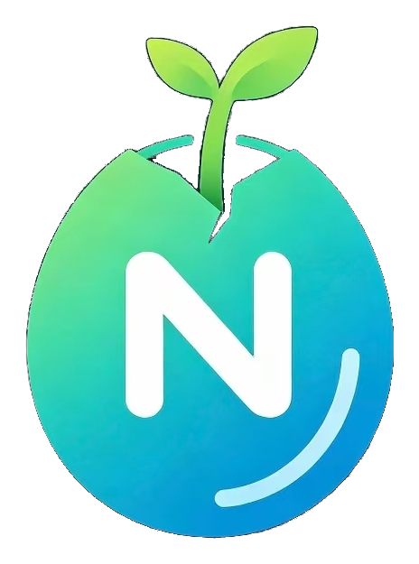

<div align="center">



# 启核 · Nexcore

**下一代智能内核 — Next Core**

团队官网源码 · 纯静态 / 零依赖 / 零构建

</div>

---

## 关于

启核（Nexcore），寓意 Next Core，代表下一代智能内核。团队由软件工程方向学生组成，
专注大模型 Agent、RAG 检索增强、算法建模与软件系统开发。

我们以严谨的数理思维构建智能系统，聚焦任务自动化调度、数据推理与工程落地，
致力于将前沿 AI 技术转化为可验证、可交付的完整项目。

## 技术方向

| 编号 | 方向 | 关注点 |
|---|---|---|
| 01 | 大模型 Agent 系统 | 任务编排、工具调用、状态管理、失败回滚 |
| 02 | RAG 检索增强 | 混合召回、重排序、引用溯源、知识库工程 |
| 03 | 算法建模与数值求解 | 数学规划、启发式搜索、数值迭代、灵敏度分析 |
| 04 | 软件系统开发 | 接口契约、测试与日志、部署交付 |

## 核心架构

总官网的“核心架构”章节提供六张可切换架构图，并可直接打开对应技术文章：

- 执行闭环：规划、工具调用、观察、证据写回与交付门禁。
- 项目记忆：`.NexcoreWork` 项目事实、SQLite 检索索引与跨轮次召回。
- 本地存储：应用状态数据库与用户工作区的数据边界。
- 视觉证据链：本地解析、视觉模型、证据融合与文本智能体。
- 上下文预算：固定规则、项目注入、历史与当前输入的分区压缩。
- 权限边界：工作区钳制、高风险审批、工具执行与审计回执。

架构 SVG 位于 `assets/architecture/`，文章 Markdown 位于 `articles/`。新增或修改文章后运行
`python scripts/build_articles.py`，同步重建 `articles/index.json` 与离线兜底包。

方向清单是数据驱动的：只需修改 `directions-data.js`，页面的方向索引、统计数字
与页脚链接会自动同步，无需改动页面代码。

## 产品矩阵

| 编号 | 产品 | 形态 | 官网 |
|---|---|---|---|
| 01 | 启核工作台 NexcoreWork | 本地智能体工作台 | https://yan-stone-computer.github.io/nexcorework-site/?v=20261027-2 |
| 02 | 启核图策 NexcoreGraph | 家庭资源智能管家 | https://yan-stone-computer.github.io/NexcoreGraph-Official/ |
| 03 | 鼓令 Drum Tide | 4v4 节庆彩墨竞技 | https://yan-stone-computer.github.io/guling-drum-tide/ |
| 04 | 天枢便签 PolarisNote | 桌面（Qt 6 / C++） | https://yan-stone-computer.github.io/polarisnote-web/ |
| 05 | 陈汉升 ChenHanshen | 安卓（Kotlin） | https://yan-stone-computer.github.io/awesome-chenhansheng-app/ |

产品清单同样是数据驱动的：修改 `products-data.js` 即可，产品索引、统计数字与
页脚产品链接会自动同步。产品图标默认取 `iconSvg`；留空则回退到 `iconImg`，
对应 `assets/` 下的图片。

## 目录结构

```text
.
├── index.html               # 单页入口（封面 / 关于 / 方向 / 产品 / 方法 / 文章 / 联系）
├── styles.css               # 设计系统：明暗主题、Apple 式留白与产品画廊
├── experience.js            # 首屏产品卡片、滚动形变、轮换与主题切换
├── script.js                # 交互：方向渲染、产品渲染、文章系统、版面动效
├── directions-data.js       # 技术方向数据（唯一需要维护的方向清单）
├── products-data.js         # 产品数据（唯一需要维护的产品清单）
├── article-config.js        # 投稿校验码（PBKDF2 慢哈希参数）与文章分类
├── articles/
│   ├── index.json           # 内置文章清单（http 环境由前端 fetch）
│   ├── offline.js           # 同上内容的内联副本（file:// 直接打开时兜底，自动生成）
│   ├── examples/            # 文章配套示例代码
│   └── *.md                 # 文章正文（Markdown）
├── scripts/
│   ├── build_articles.py    # 重建 articles/index.json 与 articles/offline.js
│   ├── test_article_loader.js  # 文章加载兜底的回归测试（纯 Node，无需浏览器）
│   └── extract_logo.py      # 从原始品牌图抽取透明底标识（可复现）
└── assets/
    ├── logo-mark.png        # 品牌标识（透明底，含破壳幼芽）— 报头 / 封面 / 页脚
    ├── logo-seed.png        # 方形图标（种子主体，适用于 App 图标等方形场景）
    ├── favicon.png
    ├── nexcoregraph-icon.png # 启核图策产品图标
    ├── guling-icon.webp      # 鼓令产品图标
    ├── nexcorework-icon.svg  # 启核工作台产品图标
    ├── chenhansheng-cover.jpg  # 陈汉升产品图标
    ├── group-qr.jpg         # 交流群二维码（联系区）
    ├── polaris-main.png     # 天枢便签主界面截图
    └── vendor/              # marked（Markdown 解析）与 DOMPurify（XSS 过滤）
```

## 本地运行

**直接双击 `index.html` 即可**：版面、文章列表、投稿表单全部可用
（浏览器在 `file://` 下会拒绝 `fetch`，此时前端自动改用 `articles/offline.js` 的
内联数据，所以双击也不会出现「暂无文章」）。

> 兜底是两层：单篇文章正文取不到时用内联副本顶上；若整份清单一篇都没能加载成功，
> 则整体切换到 `articles/offline.js`。因此「清单在、正文 404」也不会再把列表变空。

改动 `script.js` 的文章加载逻辑后，建议跑一遍回归测试：

```bash
node scripts/test_article_loader.js
```

它会在 Node 沙箱里跑真实的 `script.js`，覆盖四种场景：正文 404、正文 200、清单 404，
以及一个**反向用例**（把代码退回修复前的写法，必须能复现出「0 篇 + 空状态」）。
反向用例是为了防止测试本身失效——如果哪天它不再复现旧 bug，就说明这条测试已经失去意义了。

如需更接近线上的环境（`localStorage`、`crypto.subtle` 行为一致），任选其一：

```bash
# Python
python -m http.server 8080

# Node.js
npx serve .

# 或 VS Code / Cursor 的 Live Server 插件
```

随后访问 `http://localhost:8080`。

> 新增或修改文章后，运行 `python scripts/build_articles.py` 重新生成
> `articles/index.json` 与 `articles/offline.js`，两份清单需要保持同步。

## 技术文章投稿

页面内置投稿表单，任何人都可以发布文章，发布与删除都需要校验码。

- 校验码采用 **PBKDF2-HMAC-SHA256 慢哈希 + 随机盐**（310,000 次迭代）存储，
  配置见 `article-config.js`，明文不落盘。
- 投稿文章保存在浏览器的 `localStorage`；若需要全站共享，请接入后端存储，
  并把校验逻辑迁移到服务端执行（前端校验只能防误操作，不能防篡改）。
- 更换校验码：

```bash
node -e "const c=require('crypto');const p='你的新校验码';const s=c.randomBytes(16);\
console.log('SALT='+s.toString('base64'));\
console.log('HASH='+c.pbkdf2Sync(p,s,310000,32,'sha256').toString('base64'))"
```

把输出的 `SALT` 与 `HASH` 填回 `article-config.js` 即可。

## 设计说明

版面采用 Apple Design Language 的产品画廊方向：

1. **首屏聚焦** —— 左侧标题，右侧五张产品卡片以弧形叠放，保留充足留白。
2. **连续形变** —— 滚动进度驱动同一组卡片展开为阶梯错位排列。
3. **产品轮换** —— 侧边按钮循环整套卡片，并同步名称、类型与产品链接。
4. **双主题** —— 顶栏按钮平滑切换浅色与深色，选择保存在本地。
5. **克制动效** —— 只使用 `transform` 与 `opacity`，并遵循 `prefers-reduced-motion`。

响应式断点为 `1180 / 980 / 760 / 420 px`，正文与控件使用系统字体栈，
无需外部字体或前端构建步骤。

## 部署

这是纯静态站点，可直接托管在任意静态空间：

**GitHub Pages** — 推送仓库后，`Settings → Pages → Source` 选择
`Deploy from a branch → main → / (root)`。

**其他** — Netlify / Vercel / Cloudflare Pages 直接拖拽目录即可，
无需构建命令与输出目录配置。

## License

基于 [MIT License](./LICENSE) 开源。

---

<div align="center">

**启核 · Nexcore**

以严谨的数理思维，构建可交付的智能系统

© 2026 启核 Nexcore

</div>
